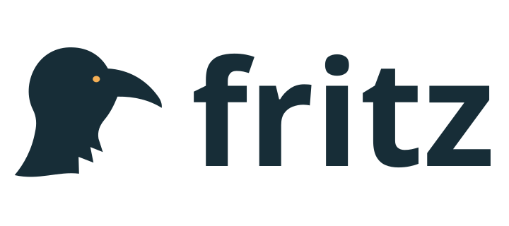

# Fritz

<picture>
  <source media="(prefers-color-scheme: dark)" srcset="design/branding/FritzLogoDark.svg">
  
</picture>

A native macOS personal assistant with persistent conversations and a choice of local or remote models. Fritz keeps chat at the center of the window. Fritz includes chat, model management, and a basic browser; [the personal assistant plan](docs/personal-assistant-plan.md) sets out how Fritz will add personal context, useful actions, and opt-in follow-through.


In **Settings → Harness**, chat context uses the selected model's limits by
default. For local chat, Fritz fits the window to available Metal memory up
to the model's limit. Fritz stops a local chat if macOS reports memory pressure
or swap use grows during the request. **Quantize Local KV Cache** can fit a larger
window by using an 8-bit attention cache. Automatic compaction summarizes older
turns as the conversation fills the context window and keeps recent turns available
to the model. You can
set a context budget, reserve space for the reply, and choose how much recent
history compaction should keep.

## Install

Open the release DMG and drag Fritz onto the Applications shortcut. Eject the
disk image, then open Fritz from Applications.

## Fritz for iPhone

The iPhone beta runs on iOS 18 or later. It supports OpenAI, OpenRouter, and
OpenAI-compatible HTTPS providers, with streamed chat, saved conversations and
drafts, and per-chat model selection. Chats and provider settings are stored
separately on each device. The Mac edition also includes local model downloads,
folder actions, decision models, and a browser.

In **Providers**, add your endpoint and API key if needed. Load the model catalog
or enter the model ID yourself. Open **New Chat** and choose the connection and
model from the toolbar. Fritz stores keys in the iPhone Keychain and sends the
conversation to the chosen provider when you send a message.

See the [iPhone privacy policy](docs/ios-privacy.md) and
[iPhone build and TestFlight guide](docs/agents/ios-release.md).

## Get started on Mac

1. Create a conversation with **New Chat** or ⌘N. In the composer, click
   **Choose Model…** to browse all known chat models. **Local** and **Remote**
   filters come first; search and provider filters also include models that have
   not been configured yet.
2. Choose a model. A ready model is selected immediately. Otherwise its setup
   dialog opens: local models show the download size, memory recommendation,
   and destination before downloading; remote models request provider setup
   when needed. Fritz stores credentials in macOS Keychain. Successful setup
   selects that model in the conversation; cancellation preserves the draft.
3. Use **File → New Local Model** or **File → New Remote Model**, the toolbar's
   CPU (local) and network (remote) buttons, or the **Models** menu to open the
   separate lists. Local Models contains models downloaded and run by Fritz.
   Expand a family folder such as Qwen to see its models, or search by model or
   family name to see matching models directly.
   API services such as Ollama belong to Remote Models, including when hosted on this Mac.
   Remote Models shows providers with a comma-separated model summary, recent
   selections first. Use the filter menu in either window to show LLMs or
   decision models. Local Models also filters by download status, benchmark score,
   whether the model fits this Mac, and **Abliterated**. Click the Score header to
   sort models within each folder and place folders by their first matching model.
   **New Remote Model…** also supports custom endpoints and model
   IDs. Catalog presence alone does not establish account access or readiness.

Model management is outside Settings. Conversations retain their own
transcripts, drafts, selected models, and model settings across launches.

Chat supports OpenAI, Anthropic, Google Gemini, OpenRouter, Ollama, and
OpenAI-compatible services. Native local models run through llama.cpp with
Metal acceleration, without an Ollama installation or API key. Each conversation
uses Rig's agent runtime inside a separate bundled `fritz-harness` process.
Decision models provide separately invoked typed judgments and are not chat models.

The local download catalog includes Dolphin 3.0 (Llama 3.2 3B and Llama 3.1
8B), Hermes 3 Llama 3.1 8B, and Mistral Nemo 12B Instruct alongside Qwen and
the other bundled choices. These downloads use Q4_K_M GGUF quantization; the
picker shows download sizes and recommended memory. Model licenses are available
under **Settings → General → Licenses**. While downloading, Fritz shows transfer
speed and estimated time remaining. Restart an interrupted download in the same
storage folder to resume it.

The **Abliterated** filter shows Huihui Qwen3 4B Instruct 2507 and Nueva Tech Qwen3
8B v2, two variants modified to reduce refusals. The same filter is available
in the [web catalog](https://fritz.rel.me/catalog).

**Settings → General → Model storage** selects the app-wide folder for future
native model downloads (initially `~/Models`). Download setup shows the current destination and a **Change…** button that
opens this preference. The folder picker is available only in Settings. If the previous folder contains downloaded models,
choose **Move Models**, **Keep Existing**, or **Cancel**. Keep Existing preserves
those models at their saved locations. Move Models copies and verifies only
Fritz-managed catalog files, then updates their locations and removes the originals;
unrelated files and models in other folders stay in place. Stop affected local
models and finish downloads before moving storage. A cancelled or interrupted copy
keeps the previous setting and originals; retrying reuses verified completed copies.
If original-file cleanup fails after publication, Fritz reports that copies remain.
The installed-model form shows its actual **Stored in** folder.

For fewer refusals, [Dolphin's publisher](https://huggingface.co/dphn/Dolphin3.0-Llama3.1-8B)
describes its models as steerable, with alignment controlled by your system
prompt. [Hermes 3](https://huggingface.co/NousResearch/Hermes-3-Llama-3.1-8B)
is another instruction-following and roleplay option. These are publisher
descriptions, not a Fritz evaluation of refusal rates or model quality;
responses still depend on the model and prompt. The 3B Dolphin download is
about 2.02 GB with 8 GB RAM recommended; both 8B downloads are about 4.92 GB
with 16 GB recommended. Nemo is about 7.48 GB with 24 GB recommended.

Fritz currently groups conversations under projects in the sidebar. Attaching a
folder lets models with native tool support read and change files and run local
processes. **These actions run with your macOS user permissions; the folder is
not an OS sandbox.** Attach only folders you trust. This workflow is planned to
move toward narrower, permission-based personal sources. See [folder access and limits](docs/folder-actions.md).

## Browser

Choose **Browser → Show Browser** (⌘2) to open the right sidebar for manual
browsing alongside chat. The toolbar’s right-sidebar button shows or hides it.
On opening, the browser takes half the workspace width excluding the left sidebar,
with a minimum width of 320 points. Drag its divider to resize it.
Enter an HTTP or HTTPS address, use tabs to keep pages open, and
navigate with Back, Forward, Reload, and Stop. The tab strip supports drag
reordering and a More tabs menu when space is limited. Right-click a tab for
close actions. Closing the last tab leaves a centered New Tab button
for opening another tab. Use Control-Tab and Control-Shift-Tab to cycle tabs, ⌘T for a new tab, ⇧⌘W to
close a tab, ⌘L to focus the address field, and ⌘R to reload. Tabs stay open when
the sidebar is hidden and reset when the workspace window closes or Fritz quits. Website data persists within the app's browser
profile. The browser does not expose pages to chat. Downloads
and requests for privileged website access are outside this initial browser.

Use **Browser → Import Cookies and Passwords…** to merge data from a local
Chrome, Chromium, Brave, or Edge profile into this Fritz build. Choose cookies,
saved passwords, or both. Import reads the source databases without changing
them; macOS may request permission to read the source browser’s Safe Storage
Keychain item. Matching cookies and website accounts are replaced. Expired and
partitioned cookies, blocked logins, and unsupported login types are skipped
and counted. Unsupported database/encryption formats fail explicitly. An
interrupted import reports how many records were written; retrying is safe.

Imported website passwords live in Fritz’s own Keychain service, separately
from provider credentials and browser cookie encryption. Choose **Browser →
Fill Password…** on a matching website, then choose an account. Filling targets
a visible password field in the main document, checks the exact scheme, host,
and port, and never submits the form. It does not fill cross-origin frames or
forms. If several password fields are visible, select the intended field first.
Neither import nor filling exposes browser data to chat. Each Debug or ad-hoc
rebuild has its own website-password Keychain service; signed Release builds
keep a stable service across updates. Source browser access is requested only
after choosing Import, with no background import or shared source storage.

## CLI

Install the bundled CLI from **Settings → General → Command Line**, then use
an existing provider connection:

```sh
fritz providers
fritz models
fritz chat "Help me plan a quiet weekend" --connection Fritz
```

For a checkout-local CLI, run `make install-cli`. See the [CLI guide](docs/cli.md)
for provider setup, local models, stdin input, and folder actions.

## Build and run

Requires macOS 15+, full Xcode with Swift 6.3+, and [mise](https://mise.jdx.dev/getting-started.html).
`make setup` installs the development tools pinned in `mise.toml`: Rust with
rustfmt and Clippy, Python, CMake, Node/npm, XcodeGen, GitHub CLI, and sccache.
It also installs the pinned llama.cpp source archive used by the macOS build.
Swift, SDKs, signing, and system utilities come from Xcode and macOS.

```sh
make setup     # check tools and resolve committed dependencies
make dev-open  # build and launch this checkout's Debug app
```

`CONFIGURATION=release make build` stages an optimized app at `dist/Fritz.app`.
Builds bundle the Rust runtime and Markdown resources and are locally signed by
default. See [building Fritz](docs/agents/building.md) for toolchain setup,
Debug app naming, build caches, and Xcode project details.

The default app uses system WebKit. To build the Chromium edition from the same
source, run:

```sh
make dev-open BROWSER_ENGINE=chromium
make build BROWSER_ENGINE=chromium CONFIGURATION=release
```

The opt-in build downloads a pinned upstream CEF archive for the host
architecture and checks its SHA-256 before compiling. The optimized app stages
at `dist/Fritz Chromium.app`. Chromium has its own app identity, settings, and
website data. Debug app names use `FritzWebViewDebug{PR number}` and
`FritzChromiumDebug{PR number}`, with a checkout hash when a linked branch has
no PR. Each Chromium Debug or ad-hoc rebuild receives its own encrypted browser
profile and Keychain namespace. A certificate-signed Release build uses a
stable Fritz Chromium namespace across updates. The [Fritz download page](https://fritz.rel.me/) offers a separate Apple silicon installer. Use that installer or rebuild from source to update Chromium. In-app automatic updates are available for the default WebKit edition.

Run the local checks with:

```sh
make test
make check
```

See [runtime verification](docs/agents/runtime-verification.md),
[UI verification](docs/agents/ui-verification.md), and
[AGENTS.md](AGENTS.md) for development guidance.

## Documentation

- [Using chat](docs/chat.md): projects, conversations, keyboard shortcuts, activity, and usage.
- [Providers](docs/providers.md): connections, discovery, model selection, and import/export.
- [Local models](docs/local-models.md): downloads, storage, hardware estimates, and the local API.
- [Model catalog](https://fritz.rel.me/catalog): local downloads, remote model metadata, and pricing.
- [Decision models](docs/decision-models.md): remote and experimental local judgment backends.
- [App updates](docs/updates.md): update channels and release behavior.
- [Architecture and storage](docs/architecture.md): harnesses, process ownership, and persistence.
- [Shared libraries](docs/libraries.md): Swift and Rust APIs for native hosts.
- [Private protocol](docs/protocol.md) and [decision harness](docs/decision-harness.md): integration contracts.
- [Releases](docs/agents/releases.md), [model evaluation](docs/agents/model-evaluation.md), and [development skills](docs/agents/skills.md).

## License

Fritz's app and shared libraries are licensed under **AGPL-3.0-only**. See
[LICENSE](LICENSE) and [CONTRIBUTING.md](CONTRIBUTING.md). Commercial use is
allowed under the license's source-sharing requirements. Third-party dependencies,
vendored material and model weights retain their respective licenses.
