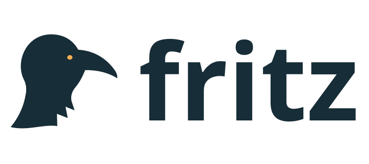

# Fritz

<picture>
  <source media="(prefers-color-scheme: dark)" srcset="design/branding/FritzLogoDark.svg">
  
</picture>

A native macOS personal assistant with persistent conversations and a choice of local or remote models. Fritz keeps chat at the center of the window. Fritz includes chat, model management, and a basic browser; [the personal assistant plan](docs/personal-assistant-plan.md) sets out how Fritz will add personal context, useful actions, and opt-in follow-through.

## Install

Open the release DMG and drag Fritz onto the Applications shortcut. Eject the
disk image, then open Fritz from Applications.

## Get started

1. Open **Settings → Models**, click **+**, and choose a provider. Add an API key
   if required; Fritz stores credentials in macOS Keychain.
2. For an on-device model, choose **New Local Model** from the **+** or **File**
   menu, download a model, and add a **Fritz** provider for it.
3. Create a conversation with **New Chat** or ⌘N, choose a model in the composer,
   and send a message. Conversations retain their own transcripts, drafts, and
   model settings across launches.

Chat supports OpenAI, Anthropic, Google Gemini, OpenRouter, Ollama, and
OpenAI-compatible services. Native local models run through llama.cpp with
Metal acceleration, without an Ollama installation or API key. Each conversation
uses Rig's agent runtime inside a separate bundled `fritz-harness` process.
Decision models provide separately invoked typed judgments and are not chat models.

Fritz currently groups conversations under projects in the sidebar. Attaching a
folder lets models with native tool support read and change files and run local
processes. **These actions run with your macOS user permissions; the folder is
not an OS sandbox.** Attach only folders you trust. This workflow is planned to
move toward narrower, permission-based personal sources. See [folder access and limits](docs/folder-actions.md).

## Browser

Choose **Browser → Show Browser** (⌘2) to open a separate window for manual
browsing. Enter an HTTP or HTTPS address, use tabs to keep pages open, and
navigate with Back, Forward, Reload, and Stop. The tab strip supports drag
reordering and a More tabs menu when space is limited. Right-click a tab for
close actions. Use Control-Tab and Control-Shift-Tab to cycle tabs, ⌘T for a new tab, ⇧⌘W to
close a tab, ⌘L to focus the address field, and ⌘R to reload. Tabs reset when
the browser window closes. Website data persists within the app's browser
profile. The browser does not expose pages to chat. Downloads
and requests for privileged website access are outside this initial browser.

Use **Browser → Import Cookies and Passwords…** to merge data from a local
Chrome, Chromium, Brave, or Edge profile into this Fritz build. Choose cookies,
saved passwords, or both. Import reads the source databases without changing
them; macOS may request permission to read the source browser’s Safe Storage
Keychain item. Matching cookies and website accounts are replaced. Expired and
partitioned cookies, blocked logins, and unsupported login types are skipped
and counted. Unsupported database/encryption formats fail explicitly. An
interrupted import reports how many records were written; retrying is safe.

Imported website passwords live in Fritz’s own Keychain service, separately
from provider credentials and browser cookie encryption. Choose **Browser →
Fill Password…** on a matching website, then choose an account. Filling targets
a visible password field in the main document, checks the exact scheme, host,
and port, and never submits the form. It does not fill cross-origin frames or
forms. If several password fields are visible, select the intended field first.
Neither import nor filling exposes browser data to chat. Each Debug or ad-hoc
rebuild has its own website-password Keychain service; signed Release builds
keep a stable service across updates. Source browser access is requested only
after choosing Import, with no background import or shared source storage.

## CLI

Install the bundled CLI from **Settings → General → Command Line**, then use
an existing provider connection:

```sh
fritz providers
fritz models
fritz chat "Help me plan a quiet weekend" --connection Fritz
```

For a checkout-local CLI, run `make install-cli`. See the [CLI guide](docs/cli.md)
for provider setup, local models, stdin input, and folder actions.

## Build and run

Requires macOS 15+, full Xcode with Swift 6.3+, and [mise](https://mise.jdx.dev/getting-started.html).
`make setup` installs the development tools pinned in `mise.toml`: Rust with
rustfmt and Clippy, Python, CMake, Node/npm, XcodeGen, GitHub CLI, and sccache.
Swift, SDKs, signing, and system utilities come from Xcode and macOS.

```sh
make setup     # check tools and resolve committed dependencies
make dev-open  # build and launch this checkout's Debug app
```

`CONFIGURATION=release make build` stages an optimized app at `dist/Fritz.app`.
Builds bundle the Rust runtime and Markdown resources and are locally signed by
default. See [building Fritz](docs/agents/building.md) for toolchain setup,
Debug app naming, build caches, and Xcode project details.

The default app uses system WebKit. To build the Chromium edition from the same
source, run:

```sh
make dev-open BROWSER_ENGINE=chromium
make build BROWSER_ENGINE=chromium CONFIGURATION=release
```

The opt-in build downloads a pinned upstream CEF archive for the host
architecture and checks its SHA-256 before compiling. The optimized app stages
at `dist/Fritz Chromium.app`. Chromium has its own app identity, settings, and
website data. Debug app names use `FritzWebViewDebug{PR number}` and
`FritzChromiumDebug{PR number}`, with a checkout hash when a linked branch has
no PR. Each Chromium Debug or ad-hoc rebuild receives its own encrypted browser
profile and Keychain namespace. A certificate-signed Release build uses a
stable Fritz Chromium namespace across updates. Existing release and automatic update targets serve the WebKit
edition. Rebuild the Chromium edition to pick up engine updates.

Run the local checks with:

```sh
make test
make check
```

See [runtime verification](docs/agents/runtime-verification.md),
[UI verification](docs/agents/ui-verification.md), and
[AGENTS.md](AGENTS.md) for development guidance.

## Documentation

- [Using chat](docs/chat.md): projects, conversations, keyboard shortcuts, activity, and usage.
- [Providers](docs/providers.md): connections, discovery, model selection, and import/export.
- [Local models](docs/local-models.md): downloads, storage, hardware estimates, and the local API.
- [Decision models](docs/decision-models.md): remote and experimental local judgment backends.
- [App updates](docs/updates.md): update channels and release behavior.
- [Architecture and storage](docs/architecture.md): harnesses, process ownership, and persistence.
- [Shared libraries](docs/libraries.md): Swift and Rust APIs for native hosts.
- [Private protocol](docs/protocol.md) and [decision harness](docs/decision-harness.md): integration contracts.
- [Releases](docs/agents/releases.md), [model evaluation](docs/agents/model-evaluation.md), and [development skills](docs/agents/skills.md).

## License

Fritz's app and shared libraries are licensed under **AGPL-3.0-only**. See
[LICENSE](LICENSE) and [CONTRIBUTING.md](CONTRIBUTING.md). Commercial use is
allowed under the license's source-sharing requirements. Third-party dependencies,
vendored material and model weights retain their respective licenses.
