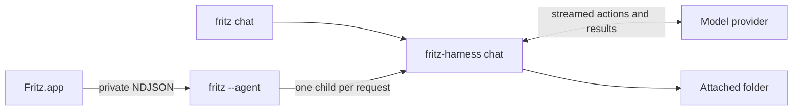

# Folder access and limits

[Back to README](../README.md)

Folder actions accept relative paths and reject parent traversal, `.git`, and symlinks
that resolve outside the selected folder. Changes require a unique `old_text` match and
replace files atomically, preserving permissions; new-file creation never overwrites.
The harness reads the folder's root `AGENTS.md` when present and instructs the model to
check nested guidance before changes.

**Local processes run with your macOS user permissions; the attached folder is a working
directory, not an OS sandbox.** Attach only folders you trust. Processes use `/bin/bash
--noprofile --norc`, a minimal environment, no interactive stdin, and a default
30-second timeout (maximum 120 seconds). Provider credentials are not passed to their
environments. Child process groups are stopped when they finish.

Each run allows 24 model turns by default (configurable up to 40), 64 actions, and 10
minutes total. File reads/writes are limited to 512 KiB; read results and each process
output stream are capped at 32 KiB. A limit, provider error, or Stop ends the run
without undoing changes already made. Review the expandable action activity before
continuing. There is no automatic rollback or background resume. Native action history,
including provider reasoning/signatures, is kept in memory within a run; persisted
follow-ups use the transcript and tool records.

The harness uses native tool protocols for OpenAI Responses, Anthropic Messages, Gemini,
Ollama, OpenRouter, and OpenAI-compatible services. A service/model that rejects tools
reports an error; there is no parsing of executable instructions from ordinary assistant
prose. See [harness protocol](protocol.md) for limits, process ownership, and
implementation details.
